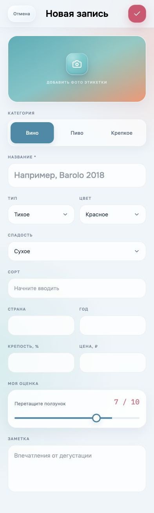

# Bodega

Личный журнал напитков для Android: сохраняйте впечатления от вина, пива и крепких напитков и собирайте рецепты коктейлей.

Без аккаунтов, ленты и подписчиков — ваш журнал остаётся личным.

## Как выглядит

Макеты основных экранов: коллекция, карточка напитка и создание записи.

<p>
  
  
  
</p>

## Возможности

- Записи с фотографиями, оценкой, заметками и характеристиками напитка.
- Отдельный раздел для рецептов коктейлей с ингредиентами и приготовлением.
- Поиск, сортировка и фильтры коллекции.
- Поиск по фотографии этикетки с распознаванием текста на устройстве.
- Необязательное облачное распознавание этикетки и создание черновика заметки через OpenRouter со своим API-ключом.
- Резервная копия журнала с фотографиями и восстановление из неё.
- Отправка текста и фотографий записи в другие приложения.

Записи хранятся на устройстве. Облачные функции выключены по умолчанию: при их включении данные, необходимые для запроса, передаются в OpenRouter. Подробнее — в [политике конфиденциальности](docs/privacy-policy.md).

## Сборка

Понадобятся Android SDK с платформой API 36 и JDK 21 для Gradle. Минимальная версия Android для приложения — **Android 8.0 (API 26)**.

Откройте проект в Android Studio и дайте Gradle синхронизировать зависимости, либо укажите путь к Android SDK в `local.properties` и выполните:

```bash
./gradlew :app:assembleDebug
```

Debug APK появится в `app/build/outputs/apk/debug/`. Для запуска модульных тестов:

```bash
./gradlew :app:testDebugUnitTest
```

Для подписанной release-сборки создайте локальный `keystore.properties` по примеру [keystore.properties.example](keystore.properties.example). Файл с ключом подписи и пароли в репозиторий добавлять не нужно.

## Устройство проекта

Приложение написано на Kotlin с Jetpack Compose. Данные и настройки хранятся с помощью Room и DataStore; для внедрения зависимостей используется Hilt. Подробнее о слоях и компонентах — в [описании архитектуры](docs/ARCHITECTURE.md).

## Лицензия

Исходный код распространяется по лицензии [MIT](LICENSE). Для включённых в проект шрифтов действуют их собственные [лицензии](docs/fonts/README.md).
