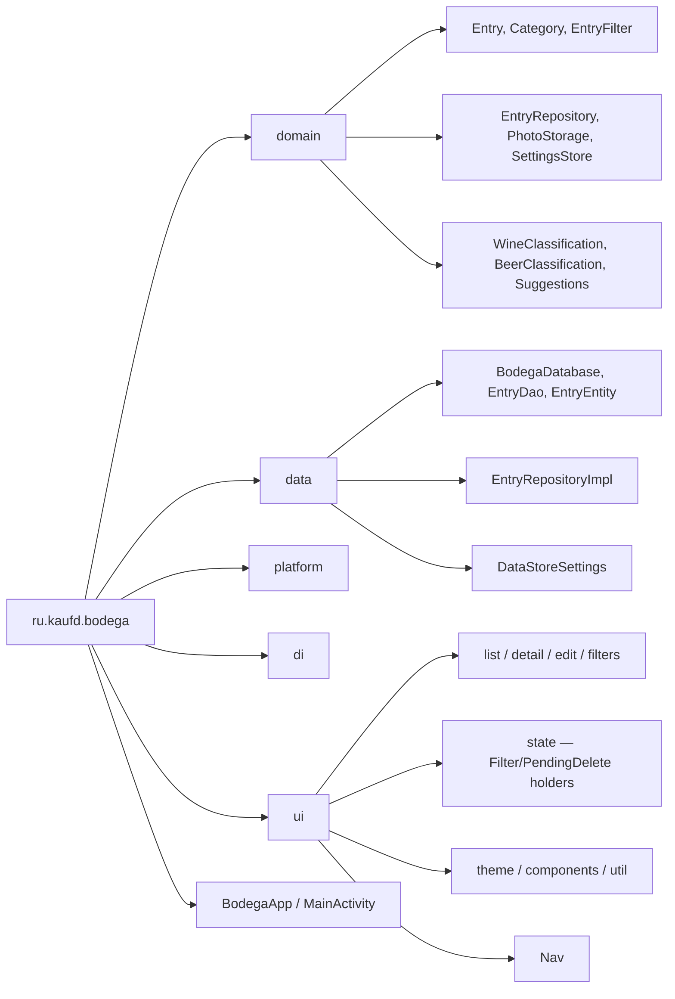
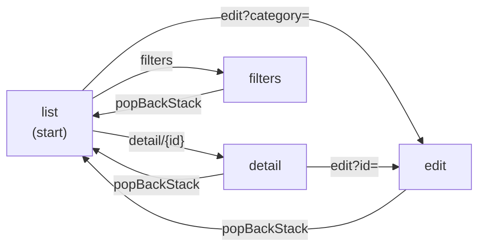
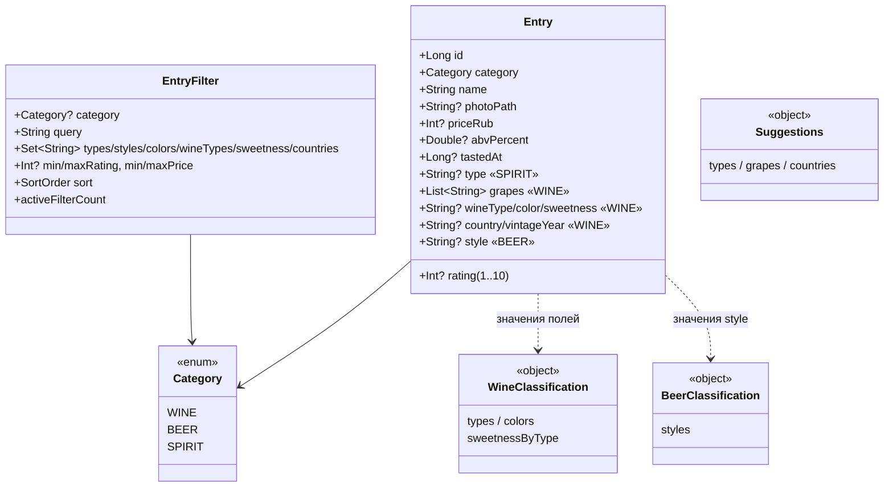
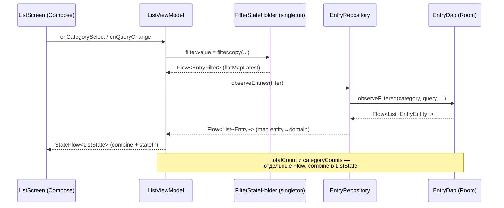
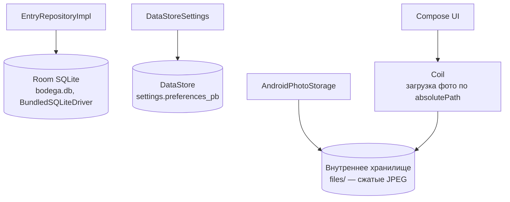

п# Архитектура Bodega

Приложение для учёта дегустаций (вино / пиво / крепкий алкоголь). Один Gradle-модуль
`:app`, пакет `ru.kaufd.bodega`. Стек: Kotlin, Jetpack Compose (Material 3),
Navigation Compose, Hilt (DI), Room (БД), DataStore (настройки), Coil (фото),
kotlinx.serialization.

Архитектура — слоистая (Clean-ish): `ui → domain ← data / platform`. Верхние слои
зависят только от **domain**-интерфейсов; конкретные реализации связываются через Hilt.

---

## 1. Слои и направление зависимостей

```mermaid
graph TD
    subgraph entry["Точка входа"]
        App[BodegaApp<br/>@HiltAndroidApp]
        Act[MainActivity<br/>@AndroidEntryPoint]
    end

    subgraph ui["ui — презентация (Compose + ViewModel)"]
        Screens[Screens<br/>List / Detail / Edit / Filters]
        VMs[ViewModels<br/>@HiltViewModel]
        Holders[State holders<br/>FilterStateHolder / PendingDeleteHolder]
        Theme[theme / components / util]
        Nav[Nav — NavHost + Routes]
    end

    subgraph domain["domain — модели и контракты (чистый Kotlin)"]
        Models[Модели<br/>Entry / Category / EntryFilter / Settings]
        Ports[Интерфейсы-порты<br/>EntryRepository / PhotoStorage / SettingsStore]
        Class[Классификаторы<br/>WineClassification / BeerClassification / Suggestions]
    end

    subgraph data["data — доступ к данным"]
        RepoImpl[EntryRepositoryImpl]
        Room[Room<br/>BodegaDatabase / EntryDao / EntryEntity]
        DSSettings[DataStoreSettings]
    end

    subgraph platform["platform — Android API"]
        Photo[AndroidPhotoStorage]
    end

    di[[di — Hilt<br/>ProvidesModule / BindsModule]]

    App --> Act --> Nav --> Screens --> VMs
    VMs --> Ports
    VMs --> Holders
    Screens --> Theme
    VMs --> Models & Class

    RepoImpl -.implements.-> Ports
    DSSettings -.implements.-> Ports
    Photo -.implements.-> Ports
    RepoImpl --> Room
    RepoImpl --> Models

    di -. связывает impl↔интерфейс .- RepoImpl
    di -. .- DSSettings
    di -. .- Photo

    classDef d fill:#f5e6c8,stroke:#a8823c
    classDef u fill:#d6e8f5,stroke:#3c6fa8
    classDef da fill:#d8f0d8,stroke:#4c9a4c
    classDef p fill:#f0d8e8,stroke:#a83c78
    class domain,Models,Ports,Class d
    class ui,Screens,VMs,Holders,Theme,Nav u
    class data,RepoImpl,Room,DSSettings da
    class platform,Photo p
```

**Правило зависимостей:** `data` и `platform` реализуют интерфейсы из `domain`;
`ui` знает только `domain`. Модуль `domain` не зависит ни от Android, ни от Room.

---

## 2. Пакеты (карта модулей)



---

## 3. Граф внедрения зависимостей (Hilt)

`SingletonComponent` — вся связка в `di/AppModule.kt`. `@Provides` создаёт
инфраструктуру, `@Binds` подменяет интерфейсы реализациями.

```mermaid
graph TD
    Ctx[Android Context] --> DB[BodegaDatabase<br/>@Singleton]
    Ctx --> Prefs[DataStore Preferences<br/>@Singleton]
    Ctx --> APhoto[AndroidPhotoStorage<br/>@Singleton]

    DB --> Dao[EntryDao]
    Dao --> RepoImpl[EntryRepositoryImpl]
    APhoto --> RepoImpl
    Prefs --> DSSettings[DataStoreSettings]

    RepoImpl == @Binds ==> IRepo[[EntryRepository]]
    DSSettings == @Binds ==> ISettings[[SettingsStore]]
    APhoto == @Binds ==> IPhoto[[PhotoStorage]]

    IRepo --> VMs[ViewModels]
    ISettings --> VMs
    IPhoto --> RepoImpl
    FHolder[FilterStateHolder<br/>@Singleton] --> VMs
    PHolder[PendingDeleteHolder<br/>@Singleton] --> VMs

    note[EditViewModel инжектит<br/>AndroidPhotoStorage напрямую<br/>ради importFromUri]
    APhoto -.-> note -.-> VMs
```

> `FilterStateHolder` и `PendingDeleteHolder` — синглтоны, поэтому состояние
> фильтра и «ожидающего удаления» (undo) переживает пересоздание ViewModel'ей и
> шарится между экранами List / Filters / Detail.

---

## 4. Навигация (Navigation Compose)



Маршруты и построители — в `ui/Nav.kt` (`object Routes`). `edit` универсален:
без параметров — новая запись, `id` — правка, `category` — стартовая категория.

---

## 5. Доменная модель



Категорийные поля `Entry` заполняются в зависимости от `category`: у вина —
`grapes/wineType/color/sweetness/country/vintageYear`, у пива — `style`, у крепкого —
`type`. В БД `grapes` сериализуется в JSON-строку `grape` (`EntryEntity`).

---

## 6. Поток данных (пример: экран списка)

Реактивный однонаправленный поток: изменения фильтра/БД → новый `ListState` → UI.



**Удаление с undo:** `ListViewModel.onDelete` кладёт запись в `PendingDeleteHolder`
(файл фото не трогается), а `purgePhoto` вызывается позже — при истечении undo или
при вытеснении предыдущего pending новым удалением.

---

## 7. Хранилища и внешние зависимости



- **Room** — источник записей; поиск по кириллице через колонку `searchText`
  (нижний регистр, сворачивание в Kotlin). Destructive fallback снят: пропущенная
  миграция роняет приложение на старте, а не стирает журнал. Версия 5 — базовая
  линия первого релиза (миграций до неё нет), с неё каждое изменение схемы требует
  +1 к `version` и своей `Migration` — см. KDoc `BodegaDatabase`.
- **DataStore** — последняя выбранная категория и порядок сортировки.
- **AndroidPhotoStorage** — импорт фото из `Uri` со сжатием, хранение в `files/`,
  удаление осиротевших файлов.
